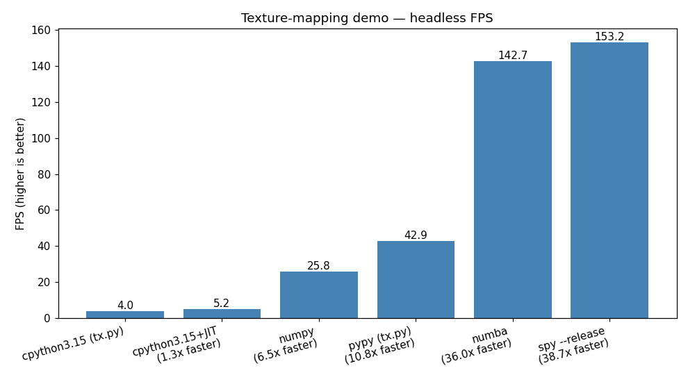

# SPy texture mapping demo

This demo shows a small software 3D texture mapper implemented in several
variants (CPython, CPython+JIT, NumPy, Numba, PyPy, and SPy), so that SPy's
runtime speed can be compared against the Python ecosystem on the same
workload.

The code is derived from Andrea Griffini's
[texture-mapping-like-in-1995](https://github.com/6502/texture-mapping-like-in-1995),
originally written for his PyCon Italy 2027 talk. The SPy port (`txspy.spy`)
mirrors the pure-Python variant closely, but with two accommodations for
current SPy limitations:

  - **Textures are pre-decoded to binary PPM.** SPy has no `subprocess` and no
    image-decoding library, so PNGs cannot be decoded at runtime. The `.ppm`
    files under this directory are the pre-decoded textures.

  - **Rendering is offloaded to `ffplay`.** SPy has no windowing/blitting
    story yet, so each variant writes P6 PPM frames to stdout and we pipe
    them into `ffplay` for display. See [`run.sh`](./run.sh).

Last tested SPy commit: `012ae501` (2026-07-07).

## Running

```
./run.sh <variant> [extra args...]
```

Variants: `py315`, `py315-jit`, `numpy`, `numba`, `pypy`, `spy`.

## Benchmark

`benchmark_all.py` runs each variant headlessly (stdout discarded) for a
fixed number of frames and records the end-to-end FPS reported by each
program.


